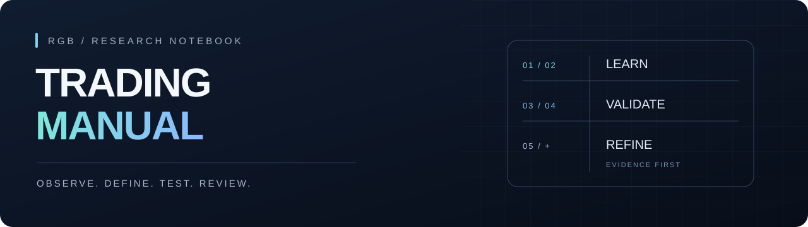

  

<h1 align="center">交易手册</h1>

  <strong>把判断写成规则，把结果留给验证。</strong> 
  RGB 的加密货币学习、模拟执行与回测档案

  <a href="#阅读导航">阅读导航</a> ·
  <a href="#验证与研究">验证与研究</a> ·
  <a href="#协作存档">协作存档</a> ·
  <a href="14-发展规划与阶段路线.md">阶段路线</a>

---

### 从这里开始

| 学习方法 | 查看执行 | 跟进进度 |
| :--- | :--- | :--- |
| **[行情判断 →](01-行情判断手册.md)** | **[模拟单方案 →](09-模拟单执行方案.md)** | **[发展路线 →](14-发展规划与阶段路线.md)** |
| 先识别状态，再找入场时机 | 查看双路入场与记账纪律 | 查看阶段、验收与进阶条件 |

> 本仓库包含**学习笔记、执行方案、待验证提案与历史回测**。不同内容的证据等级不同，结论以各章的来源、样本和方法说明为准。学习记录不构成投资建议，博主自述收益未核实。

## 阅读导航

### 01 / 判断与时机

从行情结构开始，建立一致的观察与入场语言。

| 章节 | 阅读重点 |
| :--- | :--- |
| **[01 · 行情判断手册](01-行情判断手册.md)** | 趋势与区间、强弱判断、双均线与 EMA＋分型、九步看盘 |
| **[02 · 时机篇](02-时机篇.md)** | 三种入场触发、回调结束确认、失效判定与主动离场 |
| **[06 · 适用范围与合约口径](06-适用范围与合约口径.md)** | 主流与山寨的适用边界、合约注意点、日内持仓口径 |

### 02 / 学习与来源核验

视频笔记保留出处；与画面不一致的部分，按画面订正并标注。

| 章节 | 阅读重点 |
| :--- | :--- |
| **[03 · 老K时机三课](03-学习笔记-老K时机三课.md)** | 价格行为课程第 8、9、11 课的时机规则 |
| **[04 · 已泰与幣哥逐帧复核](04-学习笔记-已泰幣哥逐帧复核.md)** | 入场片段逐帧核验、分型信号滞后与订正 |
| **[附录 · Donut 摘编](附录-Donut摘编.md)** | 《穿越浪潮》访谈摘编，作为故事与经验参考 |

### 03 / 模拟执行与复盘

把置单、观察、管理与结果记录在同一套口径下。

| 章节 | 阅读重点 |
| :--- | :--- |
| **[05 · 模拟单复盘记录](05-模拟单复盘记录.md)** | 模拟单台账、定时自查、各轮复盘记录 |
| **[09 · 模拟单执行方案](09-模拟单执行方案.md)** | 甲／乙双路、评分口径、样本纪律、平台与自动化机制 |
| **[12 · 盘中观察层方案](12-盘中观察层方案.md)** | 哨兵盯价、事件巡检、被动／管理双账及实施记录 |

## 验证与研究

### 04 / 山寨与历史回放

提案、信号回放和机械回测分别记录，阅读时先看“测了什么”。

| 章节 | 内容定位 |
| :--- | :--- |
| **[07 · 山寨专章](07-山寨专章.md)** | 选币过滤、入场触发、双底止损，以及尚未解决的问题 |
| **[08 · 山寨观察方案](08-山寨观察方案-提案待验证.md)** | **待验证提案**：相对强弱、龙头、止损指标及数据可得性 |
| **[10 · 方桦信号校准画像](10-方桦信号校准画像.md)** | **历史信号回放**：止盈止损尺度、双入场模型与方法局限 |
| **[11 · 机械回测汇总](11-机械回测汇总.md)** | **机械近似回测**：双路入场、离场与过滤规则的对照结果 |

### 05 / 发展路线

**[14 · 发展规划与阶段路线 →](14-发展规划与阶段路线.md)**

查看六个阶段各自做什么、如何验收、满足什么条件才能继续推进。实际启动、结束及实盘阶段以台账记录和 RGB 的决定为准。

---

## 协作存档

任务书、AI 回执、评估及配套数据统一放在 **[协作存档/](协作存档/)**，不属于手册正文。

| 文件 | 用途 |
| :--- | :--- |
| [山寨止损 ATR 化 · 回测任务](协作存档/回测任务-山寨止损ATR化.md) | 原始问题、固定参数与结论门槛 |
| [山寨止损 ATR 化 · GPT 回执](协作存档/回测结果-山寨止损ATR化-GPT回执.md) | 完整结果、数据限制与待 Muse 核对事项 |
| [方桦山寨信号 · 11 条数据](协作存档/数据-方桦山寨信号11条.csv) | 回测输入数据 |
| [接入自动化 · 前提与路径](协作存档/接入自动化的前提与路径.md) | 自动执行支线的评估与进入条件 |

> **目录约定**：根目录 01–12、14 章与附录为正文；保留现有编号，不用协作文件补占章节号。首页视觉资源存放于 `协作存档/首页资源/`，仅用于展示。

## 给协作 AI 的说明（GPT、Claude 及任何往本仓写文件的 AI，先读这里）

2026-11-14 RGB 定。起因：回执和任务书曾直接堆在仓库根目录，还占用了章节编号（出现过三个「13-」文件），把手册正文搞乱了。为免重犯，请遵守：

1. **根目录只放手册正文**：编号章节、附录、README。其他任何文件不要放根目录。
2. **协作文件一律进 `协作存档/`**：任务书、回执、评估、配套数据都放这个文件夹；文件名写清内容与来源（如「回测结果-山寨止损ATR化-GPT回执」），**不要用章节编号当前缀，不要冒充正文章节**。
3. **回执不要贴进正文**：回执全文归档在 `协作存档/` 即可；正文章节需要引用结论时，只写结论并注明出处「详见协作存档/××」。
4. **新增正文章节须先经 RGB 批准**，编号由 Muse 统一顺延；拿不准某个文件放哪，先问 RGB 或 Muse，不要自己在根目录新建。

---

<strong>主要来源 · YouTube</strong>

- 已泰《5分钟日内交易策略》 https://www.youtube.com/watch?v=f-YB3Qdw_EU
- 以太坊教授幣哥《双均线交易系统教学》 https://www.youtube.com/watch?v=vdCdg4MdwBs
- 狗狗币大师兄《币圈K线分析4项基础技能》 https://www.youtube.com/watch?v=IV7drkfv6jA
- Trader老K《价格行为》系列（第 3、8、9、11 课等） https://www.youtube.com/playlist?list=PLWfRP99Ho4Pj7xWnDSIh0ufU_RgjQSBwe
- 脑总MrBrain《一口气讲透K线技术分析》 https://www.youtube.com/watch?v=eV2YqJYfjUQ

整理：Muse（受 RGB 委托学习并总结），2026-11-12。

  学习有出处 · 执行有记录 · 结论有边界 
  <a href="#阅读导航">返回阅读导航 ↑</a>

